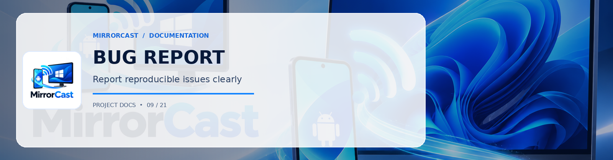

**Describe the bug**
A clear and concise description of what the bug is.

**To Reproduce**
Steps to reproduce the behavior:
1. Launch Windows Receiver on PC ('...')
2. Open Android Sender app on Phone ('...')
3. Attempt to connect via ('mDNS / QR code / Manual IP')
4. See error

**Expected behavior**
A clear and concise description of what you expected to happen.

**Device & Environment Information:**
 - Android Device: [e.g. Pixel 8, Samsung Galaxy S24]
 - Android OS Version: [e.g. Android 14, Android 13]
 - Windows Version: [e.g. Windows 11 23H2, Windows 10 22H2]
 - Wi-Fi Frequency: [e.g. 5GHz, 2.4GHz, Android Hotspot]
 - Network Isolation: [e.g. Home Router, Corporate Network]

**Logs / Screenshots**
If applicable, add screenshots or output from Windows telemetry/Android logcat (`adb logcat -s WebRtcStreamManager SignalingClient ScreenCaptureService`).

**Additional context**
Add any other context about the problem here.
