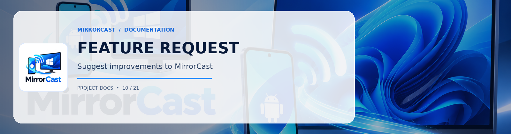

**Is your feature request related to a problem? Please describe.**
A clear and concise description of what the problem is. Ex. I'm always frustrated when [...]

**Describe the solution you'd like**
A clear and concise description of what you want to happen.

**Component**
- [ ] Android Sender (Capture / Encoding / Compose UI)
- [ ] Windows Receiver (Rendering / Signaling Server / WPF UI)
- [ ] WebRTC / Video Pipeline (H.264 / VP8 / Bitrate adaptation)
- [ ] Discovery / Pairing (mDNS / QR code / Security)

**Describe alternatives you've considered**
A clear and concise description of any alternative solutions or features you've considered.

**Additional context**
Add any other context or screenshots about the feature request here.
