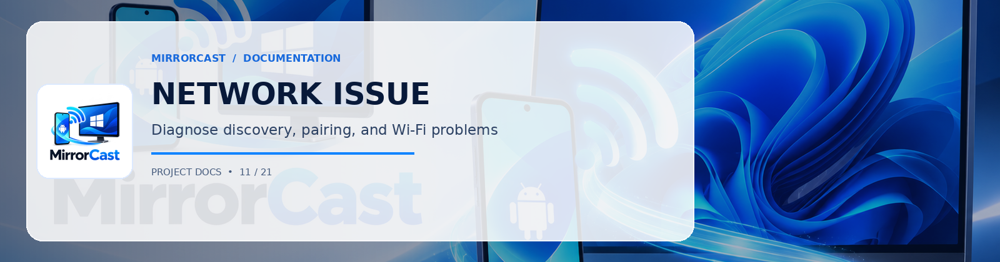

**Network Architecture & Setup**
- Router / Access Point Model:
- Wi-Fi Frequency: [2.4 GHz / 5 GHz / 6 GHz]
- Channel Width: [20 MHz / 40 MHz / 80 MHz / 160 MHz]
- Phone IP: (e.g. 192.168.1.102)
- PC IP: (e.g. 192.168.1.55)
- Same Subnet: [Yes / No]

**Symptoms Observed**
- [ ] Windows Receiver not found via automatic discovery (mDNS)
- [ ] WebSocket connection timeout on port 8089
- [ ] Pairing PIN rejected
- [ ] WebRTC ICE negotiation failed (state: failed/disconnected)
- [ ] Video stream stutters / high latency (>200ms)
- [ ] Dropped frames under network load

**Firewall & Port Status**
- Inbound TCP 8089 rule added: [Yes / No]
- Inbound UDP WebRTC rule added: [Yes / No]
- Windows Defender / Third-party firewall: [Specify]

**Observed Telemetry on PC**
- FPS displayed:
- Bitrate displayed (Mbps):
- Packets lost:

**Diagnostic Steps Attempted**
Describe what you have tried based on [docs/troubleshooting.md](https://github.com/0xSHARON/mirrorcast/blob/main/docs/troubleshooting.md).
