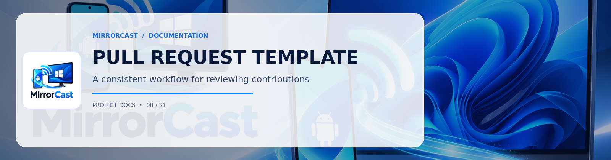

## Description
<!-- Provide a concise explanation of the changes introduced in this pull request. -->

## Component Affected
- [ ] Android Sender (`android/`)
- [ ] Windows Receiver (`windows/`)
- [ ] Signaling Protocol (`protocol/`)
- [ ] Documentation (`docs/`)
- [ ] Build Scripts (`scripts/`)

## Related Issues
<!-- Fixes #(issue number) -->

## Type of Change
- [ ] Bug fix (non-breaking change fixing an issue)
- [ ] New feature (non-breaking change adding functionality)
- [ ] Performance improvement (latency reduction, memory optimization)
- [ ] Breaking change (fix or feature modifying the signaling schema)
- [ ] Documentation update

## Checklist
- [ ] My code adheres to the project's coding conventions (Kotlin / C#).
- [ ] I have executed the automated test suites (`dotnet test` and `./gradlew test`).
- [ ] I have added/updated unit tests covering my changes.
- [ ] If modifying the signaling contracts, I have updated `protocol/signaling-schema.json` and `docs/protocol.md`.
- [ ] Tested on a physical Android device or Windows PC (if applicable).
