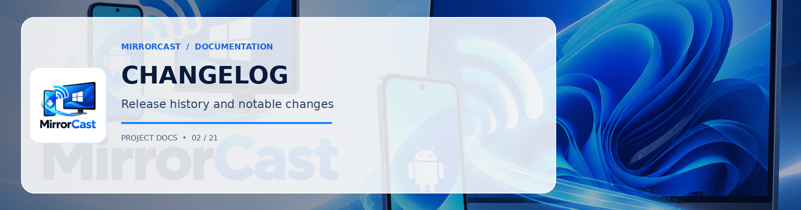

# Changelog

All notable changes to the MirrorCast project are documented in this file.

The format is based on [Keep a Changelog](https://keepachangelog.com/en/1.0.0/),
and this project adheres to [Semantic Versioning](https://semver.org/spec/v2.0.0.html).

---

## [1.0.0] - 2026-10-18

### Initial Release

#### Android Sender
- **MediaProjection Engine**: Real-time screen capture via Android `MediaProjection` API with full Android 14+ foreground service lifecycle management (`FOREGROUND_SERVICE_MEDIA_PROJECTION`).
- **Hardware Acceleration**: Integrated `DefaultVideoEncoderFactory` targeting hardware-accelerated H.264 / VP8 via Android `MediaCodec`.
- **System Audio Streaming**: Integrated `JavaAudioDeviceModule` and WebRTC audio transceiver with support for system audio and microphone capture.
- **Persistent Settings**: Persistent configuration for resolution (720p/1080p/1440p), frame rate (30/60/90 fps), bitrate (4-12 Mbps), codec, and theme modes stored via `SharedPreferences`.
- **Modern UI**: Jetpack Compose and Material 3 interface with dark theme, nearby receiver discovery list, direct PIN entry dialog with instant auto-connect, and active streaming HUD.
- **Discovery**: Automatic mDNS responder scanner (`_mirrorcast._tcp`) via Android `NsdManager`, High-Speed USB direct connection, and manual IP fallback.
- **QR Code Pairing**: Direct scanning of receiver pairing QR codes via ZXing integration.
- **Author Profile Navigation**: Integrated direct GitHub navigation to [@0xSHARON](https://github.com/0xSHARON).
- **Dynamic Rotation**: Automatic surface format reconfiguration on screen rotation without dropping the WebRTC session.

#### Windows Receiver
- **Desktop Host**: .NET 9 WPF application featuring modern Fluent dark theme, responsive viewport, and telemetry counters.
- **Connection Approval Security**: Mandatory incoming connection modal requiring explicit user confirmation before any screen or audio transmission begins.
- **Interactive Settings**: Real-time configuration for approval popups, USB auto-approval, PIN authentication, remote control, and custom signaling ports.
- **Hardware-Accelerated WebRTC**: Embedded W3C `RTCPeerConnection` with Direct3D11 / DXVA hardware decoding and audio playback via Microsoft WebView2.
- **Local Signaling Server**: Asynchronous HTTP and WebSocket server on port `8090` handling SDP offer/answer exchange, ICE candidates, and telemetry.
- **Streamlined Status Interface**: Focused status header with active device details, IP, and duration timer.
- **Authentication**: Cryptographically secure random PIN generation with rate limiting.
- **QR Code Display**: High-resolution scannable QR code generation using `QRCoder` bound to active network interfaces.
- **mDNS Advertisement**: Automatic local network broadcasting via `Makaretu.Dns.Multicast`.
- **Diagnostics**: Real-time telemetry monitoring for frame rate (FPS), bitrate (Mbps), and packet loss.

#### Documentation & Testing
- Standardized WebSocket signaling schema (`protocol/signaling-schema.json`).
- Complete architecture, protocol, security, troubleshooting, and performance tuning documentation.
- Automated PowerShell build scripts for Windows (`build-windows.ps1`) and Android (`build-android.ps1`).
