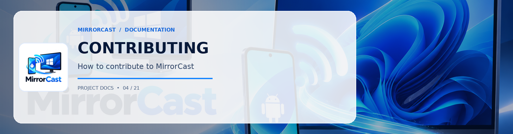

# Contributing to MirrorCast

Thank you for your interest in contributing to **MirrorCast**, created by [0xSHARON](https://github.com/0xSHARON)!

Official Repository: [https://github.com/0xSHARON/mirrorcast](https://github.com/0xSHARON/mirrorcast)

We welcome contributions to both the Android sender and Windows receiver applications.

---

## Code of Conduct

Please maintain a collaborative, respectful, and productive environment. We prioritize code clarity, rigorous security practices, and reliable automated testing.

---

## Development Workflow

1. **Fork and Clone**: Clone your fork of the repository locally.
2. **Branching**: Create a descriptive feature branch:
   ```bash
   git checkout -b feature/adaptive-fps
   ```
3. **Coding Standards**:
   - **Android (Kotlin)**: Follow the [official Kotlin Coding Conventions](https://kotlinlang.org/docs/coding-conventions.html) and Compose best practices (state hoisting, single directional data flow).
   - **Windows (.NET / C#)**: Follow Microsoft C# coding conventions, nullable reference type annotations (`#nullable enable`), and clean MVVM patterns.
4. **Signaling Protocol Invariant**: Any changes to the WebSocket signaling contracts must update:
   - [protocol/signaling-schema.json](protocol/signaling-schema.json)
   - [docs/protocol.md](docs/protocol.md)
   - C# data models in `windows/MirrorCast.Receiver/Signaling/`
   - Kotlin data models in `android/app/src/main/java/com/mirrorcast/app/signaling/`
5. **Testing**:
   Run both automated test suites before submitting a PR:
   ```powershell
   # Windows Tests
   cd windows; dotnet test

   # Android Tests
   cd android; .\gradlew testDebugUnitTest
   ```
6. **Pull Requests**:
   - Provide a clear summary of your changes.
   - Include before/after performance benchmarks if changing encoding or bitrate settings.
