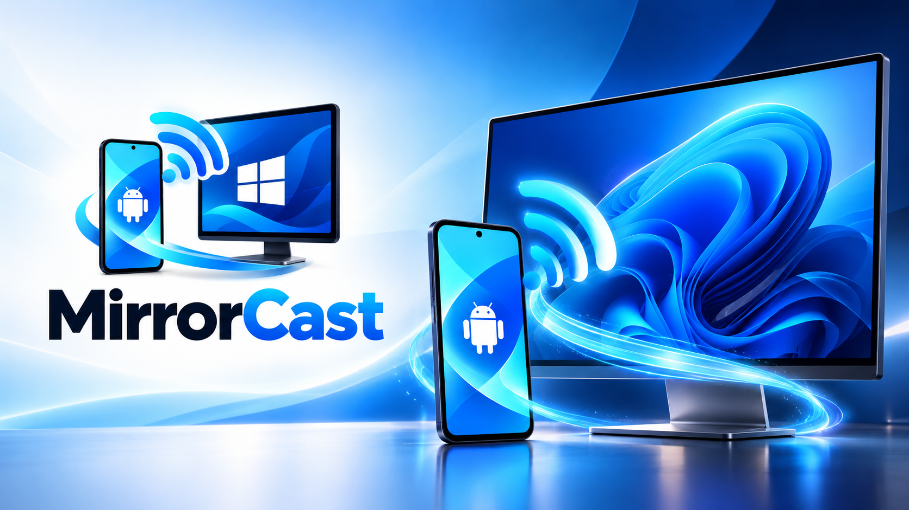
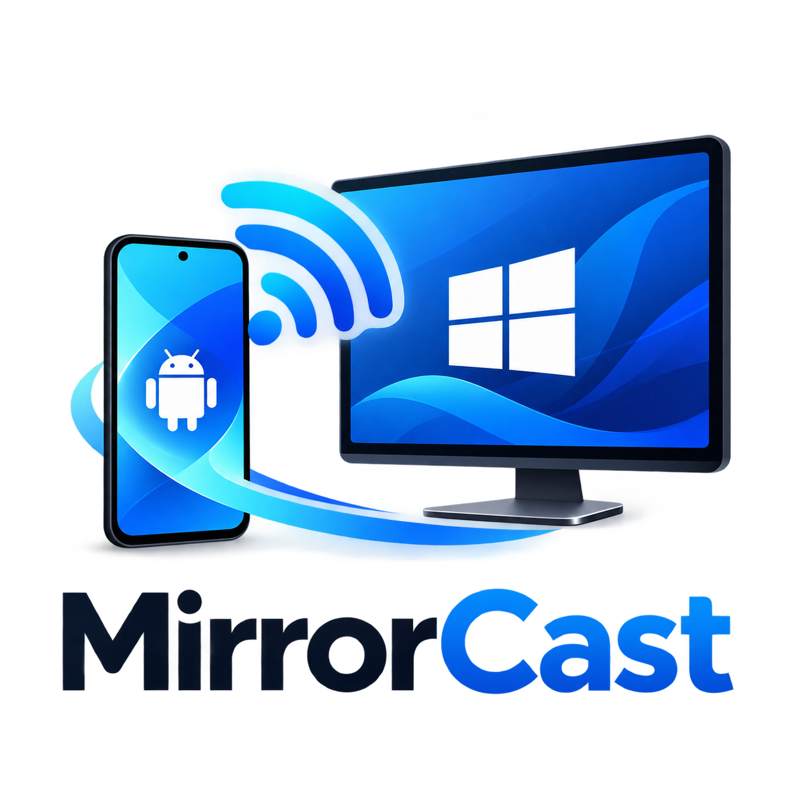

<p align="center">
  
</p>

<p align="center">
  
</p>

<h1 align="center">MirrorCast 📺</h1>

<p align="center">
  <strong>Ultra-Low Latency Android to Windows Screen Mirroring over Local Wi-Fi</strong><br>
  <em>Powered by WebRTC, Hardware-Accelerated H.264 Video Codecs, and Jetpack Compose</em>
</p>

<p align="center">
  <a href="https://github.com/0xSHARON/mirrorcast/stargazers"></a>
  <a href="https://github.com/0xSHARON/mirrorcast/releases/latest"></a>
  <a href="https://github.com/0xSHARON/mirrorcast/releases"></a>
  <a href="https://0xsharon.github.io/mirrorcast/"></a>
  <a href="CONTRIBUTING.md"></a>
  <a href="LICENSE.md"></a>
</p>

<p align="center">
  🌐 <strong>Live Website & Protocol Docs:</strong> <a href="https://0xsharon.github.io/mirrorcast/">https://0xsharon.github.io/mirrorcast/</a>
</p>


---

## Architecture Overview

```
+-----------------------------------------------------------------------------------------+
|                                    ANDROID SENDER                                        |
|                                                                                         |
|  +---------------------+        +--------------------+        +---------------------+  |
|  |  Jetpack Compose UI |        |   Foreground Svc   |        | MediaProjection API |  |
|  | (Discovery/Pairing) |<------>| (Android 14 Media) |<------>|  (Screen Capture)   |  |
|  +---------------------+        +--------------------+        +----------+----------+  |
|                                                                          |              |
|                                                                Virtual Display / Surface|
|                                                                          v              |
|  +---------------------+        +--------------------+        +---------------------+  |
|  |   OkHttp WebSocket  |        | Stream WebRTC Core |        | Android MediaCodec  |  |
|  |   Signaling Client  |        | PeerConnection Mgr |<-------+ (Hardware H.264/VP8)|  |
|  +----------+----------+        +----------+---------+        +---------------------+  |
+-------------|------------------------------|--------------------------------------------+
              |                              |
    Local Signaling (JSON/WS)      Encrypted RTP Media (SRTP/UDP)
              |                              |
+-------------|------------------------------|--------------------------------------------+
|             v                              v                                            |
|  +---------------------+        +--------------------+        +---------------------+  |
|  | Managed WebSocket   |        | W3C WebRTC Engine  |        | Hardware Decoder    |  |
|  | Signaling Server    |        | (RTCPeerConnection)|------->| (Direct3D11 / DXVA) |  |
|  +----------+----------+        +----------+---------+        +----------+----------+  |
|             |                              |                             |              |
|             v                              +--------------+--------------+              |
|  +---------------------+                                  |                             |
|  | C# Pairing & Session|                                  v                             |
|  | Manager & mDNS Adv  |                       +---------------------+                  |
|  +---------------------+                       | WPF Desktop Window  |                  |
|                                                | & Render Viewport   |                  |
|                                                +---------------------+                  |
|                                    WINDOWS RECEIVER                                     |
+-----------------------------------------------------------------------------------------+
```

---

## Key Features

- **Direct Local Peer-to-Peer**: Video travels strictly over your local Wi-Fi router. Zero cloud relays, zero external internet dependencies, zero subscriptions.
- **Hardware-Accelerated Encoding**: MediaProjection VirtualDisplay connects directly to Android `MediaCodec` H.264 hardware encoders for sub-80ms glass-to-glass latency.
- **Hardware-Accelerated Decoding**: Windows desktop utilizes Direct3D11 / DXVA hardware video decoding via Microsoft WebView2.
- **Zero-Friction Pairing**: Automatic mDNS discovery (`_mirrorcast._tcp`), scannable QR Code pairing, and 6-digit cryptographic PIN authentication.
- **Android 14 / 15 Compliant**: Adheres to modern foreground service media projection requirements, explicit system consent intents, and permission revoking callbacks.
- **Adaptive Streaming**: Dynamic resolution, framerate, and keyframe generation responding to Wi-Fi jitter and packet loss.

---

## Repository Structure

```
MirrorCast/
├── README.md
├── docs/
│   ├── architecture.md          # Complete system architecture and pipeline diagrams
│   ├── protocol.md              # WebSocket signaling protocol specification
│   ├── security.md              # Authentication, pairing, and transport security model
│   └── troubleshooting.md       # Wi-Fi isolation, firewall, and permission fixes
├── protocol/
│   └── signaling-schema.json    # JSON Schema definition for signaling messages
├── android/
│   ├── app/                     # Native Android Kotlin Application
│   │   ├── src/main/java/com/mirrorcast/app/
│   │   │   ├── discovery/       # Android NSD / mDNS discovery & QR parser
│   │   │   ├── service/         # Foreground MediaProjection capture service
│   │   │   ├── signaling/       # OkHttp WebSocket signaling client & data models
│   │   │   ├── ui/              # Jetpack Compose & Material 3 screens
│   │   │   └── webrtc/          # WebRTC peer connection & screen capture manager
│   │   └── src/test/            # Unit tests for protocol & QR parsing
│   ├── build.gradle.kts
│   └── settings.gradle.kts
├── windows/
│   ├── MirrorCast.Receiver.sln
│   ├── MirrorCast.Receiver/     # C# .NET 9 WPF Desktop Application
│   │   ├── Discovery/           # mDNS responder & network adapter utils
│   │   ├── Security/            # PIN generator & session manager
│   │   ├── Signaling/           # WebSocket HTTP/WS server & message dispatch
│   │   ├── ViewModels/          # MainViewModel with telemetry & commands
│   │   └── WebRtc/              # WebView2 WebRTC host controller & renderer HTML
│   └── MirrorCast.Receiver.Tests/ # xUnit test suite (10 automated tests)
└── scripts/
    ├── build-android.ps1        # PowerShell script to compile Android APK
    └── build-windows.ps1        # PowerShell script to build & test Windows Receiver
```

---

## Prerequisites

1. **Windows PC**:
   - Windows 10 (version 1809+) or Windows 11.
   - [.NET 9.0 SDK](https://dotnet.microsoft.com/download/dotnet/9.0) or later.
   - Microsoft Edge WebView2 Runtime (pre-installed on modern Windows 10/11).
2. **Android Phone**:
   - Android 8.0 (API 26) through Android 15 (API 35).
   - JDK 17 or 21 (for building Android APK).
   - Android SDK with platform tools & platform 34.

---

## Quick Start Guide

### 1. Build and Run Windows Receiver
Open PowerShell in the project root:
```powershell
.\scripts\build-windows.ps1
```
To launch the receiver:
```powershell
.\windows\MirrorCast.Receiver\bin\Release\net9.0-windows\MirrorCast.Receiver.exe
```
Upon opening, MirrorCast will:
- Automatically bind to your local Wi-Fi IP address (e.g. `192.168.1.55:8089`).
- Generate a new 6-digit PIN and display a scannable pairing QR code.
- Begin broadcasting mDNS service `_mirrorcast._tcp`.

> **Note on Windows Firewall**: If prompted by Windows Defender Firewall, check **Private networks** and click **Allow access**. You can also click the **🛡️ Allow Windows Firewall** button inside the app.

---

### 2. Build and Install Android Sender
```powershell
.\scripts\build-android.ps1
```
Install the APK onto your connected phone via ADB:
```powershell
adb install -r android\app\build\outputs\apk\debug\app-debug.apk
```

---

### 3. Connect and Mirror

1. Connect your Android phone to the **same Wi-Fi network** as your Windows PC.
2. Open **MirrorCast** on Android.
3. You have two instant options to connect:
   - **Automatic Discovery**: Tap on your PC when it appears in the *Nearby Windows Receivers* list, then enter the 6-digit PIN.
   - **QR Code Scan**: Tap **Scan QR Code** and point your phone's camera at the QR code on your PC screen.
4. When Android prompts:
   > *"MirrorCast will have access to everything displayed on your screen"*
   Tap **Start now**.
5. Your Android screen will instantly appear in real-time on your Windows PC!

---

## Running the Automated Test Suites

### Windows Receiver Tests (xUnit)
```powershell
cd windows
dotnet test
```
Verifies:
- 6-digit cryptographic PIN generation.
- PIN authentication and automatic invalidation on brute force attempts.
- Session authorization and revocation.
- QR code payload creation and parameter extraction.
- Signaling message serialization & deserialization (Offer, Answer, ICE candidates).

### Android Sender Tests (JUnit)
```powershell
cd android
.\gradlew testDebugUnitTest
```
Verifies:
- Kotlin signaling message serialization adhering to `protocol/signaling-schema.json`.
- QR code URI schema parser (`mirrorcast://pair?...`).
- Invalid parameter rejection.
