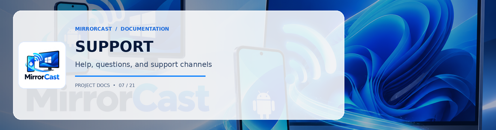

# Support for MirrorCast

Thank you for using **MirrorCast** created by [0xSHARON](https://github.com/0xSHARON)!

Official Repository: [https://github.com/0xSHARON/mirrorcast](https://github.com/0xSHARON/mirrorcast)

Here are the best ways to get help and support:

---

## 1. Documentation & Self-Help
Before opening an issue, please check the project documentation:
- [docs/troubleshooting.md](docs/troubleshooting.md): Solutions for Wi-Fi client isolation, Windows Firewall configuration, and Android 14+ permissions.
- [docs/getting-started.md](docs/getting-started.md): Installation and setup instructions.
- [docs/performance-tuning.md](docs/performance-tuning.md): Guidance for reducing latency and optimizing Wi-Fi throughput.

---

## 2. GitHub Discussions & Community Help
For questions, usage advice, and general discussions:
- Start a discussion on [GitHub Discussions](https://github.com/0xSHARON/mirrorcast/discussions).
- Ask questions regarding supported hardware codecs (Qualcomm Adreno, Samsung Exynos, MediaTek, Intel QuickSync, NVIDIA NVDEC, AMD VCN).

---

## 3. Reporting Bugs & Feature Requests
- If you found a bug or crash, please open a [GitHub Issue](https://github.com/0xSHARON/mirrorcast/issues/new/choose) using our templates.
- If you have an idea for improving MirrorCast, submit a Feature Request issue.
