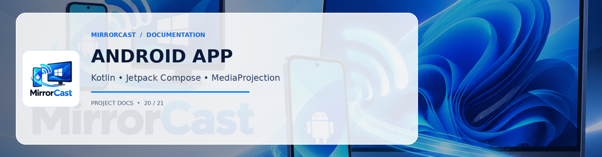

# MirrorCast — Android Sender Module

The **MirrorCast Android Sender** is a native Android application built in **Kotlin** with **Jetpack Compose** and **Material 3**. It captures the phone display via the Android `MediaProjection` API, encodes it in real time via hardware `MediaCodec` H.264, and streams it to the Windows Receiver using WebRTC.

- **GitHub Repository**: [https://github.com/0xSHARON/mirrorcast](https://github.com/0xSHARON/mirrorcast)
- **Author**: Created and maintained by [0xSHARON](https://github.com/0xSHARON)

---

## Technical Specifications

- **Language**: Kotlin 2.0.21
- **UI Framework**: Jetpack Compose (BOM 2024.10.00) & Material 3
- **Minimum SDK**: 26 (Android 8.0 Oreo)
- **Target SDK**: 34 (Android 14) / 35 (Android 15 ready)
- **Media Capture**: Android MediaProjection API
- **Video Transport**: WebRTC via `io.getstream:stream-webrtc-android:1.3.1`
- **Signaling**: OkHttp 4.12.0 WebSocket client
- **Service Type**: `foregroundServiceType="mediaProjection"`

---

## Directory Structure

```
android/
├── build.gradle.kts           # Root gradle script with Kotlin 2.0 and AGP 8.5.2
├── settings.gradle.kts        # Repository management
├── gradle.properties          # AndroidX configuration
├── local.properties           # Android SDK path
└── app/
    ├── build.gradle.kts       # App module configuration & dependencies
    ├── src/main/
    │   ├── AndroidManifest.xml # Permissions & foreground service declaration
    │   ├── java/com/mirrorcast/app/
    │   │   ├── MainActivity.kt        # App lifecycle & MediaProjection launcher
    │   │   ├── discovery/             # Network Service Discovery & QR parser
    │   │   ├── service/               # Foreground MediaProjection capture service
    │   │   ├── signaling/             # WebSocket client & JSON protocol models
    │   │   ├── ui/                    # Compose screens & theme
    │   │   └── webrtc/                # WebRTC PeerConnection & ScreenCapturerAndroid
    │   └── res/                       # Icons, strings, and layouts
    └── src/test/                      # Unit tests (GSON protocol & QR parsing)
```

---

## Building & Installing

### Command Line (PowerShell)
From the project root:
```powershell
.\scripts\build-android.ps1 -Task assembleDebug
```

To install directly to a connected USB or Wi-Fi ADB device:
```powershell
adb install -r android\app\build\outputs\apk\debug\app-debug.apk
```

### Android Studio
1. Open Android Studio (Iguana / Jellyfish or newer).
2. Select **Open** and choose the `android` folder.
3. Allow Gradle sync to complete.
4. Select `app` from the run configuration dropdown and click **Run** (`Shift + F10`).

---

## Android 14+ Permissions & Lifecycle

Under Android 14 (API 34) and Android 15:
1. `android.permission.FOREGROUND_SERVICE_MEDIA_PROJECTION` must be declared in the manifest.
2. The `ScreenCaptureService` must explicitly specify `android:foregroundServiceType="mediaProjection"`.
3. The foreground service must be started before or concurrently with the `MediaProjection` token acquisition.
4. The system MediaProjection consent dialog (`createScreenCaptureIntent`) cannot be reused; a new intent must be prompted for each streaming session.
