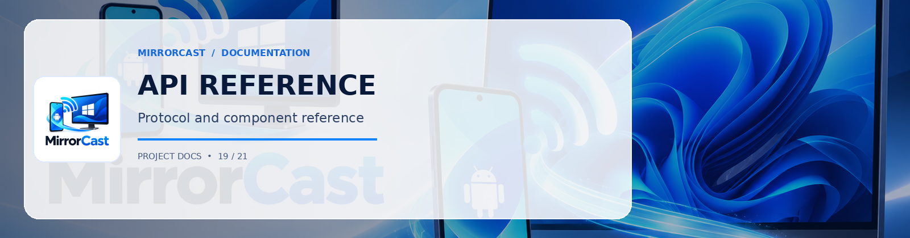

# MirrorCast — API & Architecture Reference

This document provides a technical reference of classes, interfaces, services, and event contracts across both the Android and Windows codebases.

---

## 1. Android Sender Components

### 1.1 `com.mirrorcast.app.discovery.ReceiverDiscovery`
Manages Network Service Discovery (mDNS) and QR code URI parsing.
- **`receivers: StateFlow<List<DiscoveredReceiver>>`**: Reactive flow emitting newly discovered or lost Windows receivers on the local subnet.
- **`startDiscovery()`**: Registers an `NsdManager.DiscoveryListener` for `_mirrorcast._tcp.`.
- **`stopDiscovery()`**: Unregisters discovery listeners cleanly.
- **`companion object.parseQrUri(qrContent: String): DiscoveredReceiver?`**: Parses `mirrorcast://pair?ip=...&port=...&pin=...` into a typed `DiscoveredReceiver`.

### 1.2 `com.mirrorcast.app.signaling.SignalingClient`
Handles WebSocket transport with the Windows receiver.
- **`connectionState: StateFlow<SignalingState>`**: Current signaling state (`Disconnected`, `Connecting`, `Connected`, `Paired`, `Error`).
- **`incomingMessages: SharedFlow<SignalingMessage>`**: Stream of incoming JSON signaling messages.
- **`connect(host: String, port: Int, pin: String, width: Int, height: Int, fps: Int)`**: Opens an OkHttp WebSocket to `ws://{host}:{port}/ws` and automatically sends `pair_request`.
- **`sendOffer(sdp: String)`**: Packages the local SDP offer into a `SignalingMessage` and transmits to Windows.
- **`sendIceCandidate(candidate: String, sdpMid: String?, sdpMLineIndex: Int?)`**: Transmits an ICE trickle candidate.
- **`disconnect()`**: Sends `disconnect` frame and tears down the socket.

### 1.3 `com.mirrorcast.app.webrtc.WebRtcStreamManager`
Encapsulates hardware encoding and the WebRTC peer connection pipeline.
- **`startStreaming(mediaProjectionResultData: Intent, width: Int, height: Int, fps: Int)`**: Creates an EGL context, initializes `DefaultVideoEncoderFactory` with hardware H.264 support, mounts `ScreenCapturerAndroid`, and creates the SDP Offer.
- **`updateScreenDimensions(width: Int, height: Int, fps: Int)`**: Dynamic re-encoding format adjustment when screen rotation occurs.
- **`stopStreaming()`**: Stops capture, releases EGL surfaces, disposes tracks, and closes the peer connection.

### 1.4 `com.mirrorcast.app.service.ScreenCaptureService`
An Android Foreground Service running with `foregroundServiceType="mediaProjection"`.
- Ensures compliance with Android 14+ background execution policies.
- Maintains a persistent status notification in the notification shade with a "Stop Sharing" intent action.

---

## 2. Windows Receiver Components

### 2.1 `MirrorCast.Receiver.Discovery.MdnsDiscoveryService`
- **`Start(int port, string instanceName)`**: Publishes DNS-SD service `_mirrorcast._tcp` using multicast UDP (port 5353) via `Makaretu.Dns`.
- **`Stop()`**: Unadvertises the service and stops the multicast socket.

### 2.2 `MirrorCast.Receiver.Security.PairingManager`
- **`CurrentPin`**: Generates a 6-digit cryptographic random PIN (`100000`–`999999`) using `RandomNumberGenerator.GetInt32()`.
- **`ValidatePin(string candidatePin)`**: Validates incoming PINs with rate-limiting and automatic rotation after 5 failed attempts.
- **`CreateSession(string clientDeviceName)`**: Generates an ephemeral GUID session token for approved pairings.
- **`GenerateQrCodePng(string ip, int port)`**: Generates a PNG byte buffer encoding the pairing URI for display in WPF.

### 2.3 `MirrorCast.Receiver.Signaling.SignalingServer`
- Async HTTP & WebSocket server built on `System.Net.HttpListener`.
- Upgrades `/ws` requests to `WebSocketContext`.
- Dispatches messages: `pair_request`, `offer`, `ice_candidate`, `control`, `stats`, `disconnect`.
- Serves the embedded video renderer at `http://localhost:{port}/renderer`.

### 2.4 `MirrorCast.Receiver.WebRtc.WebRtcReceiverController`
- Wires WPF's `WebView2` with the `SignalingServer`.
- Passes the SDP offer from Android into the embedded Chromium WebRTC engine.
- Relays the generated SDP Answer and local ICE candidates back to Android.
- Emits real-time video stats (FPS, bitrate, packets lost) to the ViewModel.
