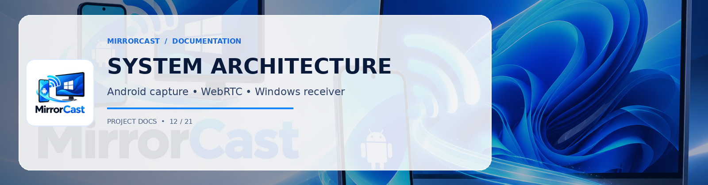

# MirrorCast System Architecture

## 1. High-Level Architecture Overview

MirrorCast provides real-time, low-latency, hardware-accelerated screen mirroring from an Android device to a Windows 10/11 desktop application across the local Wi-Fi network.

```
+-----------------------------------------------------------------------------------------+
|                                    ANDROID SENDER                                        |
|                                                                                         |
|  +---------------------+        +--------------------+        +---------------------+  |
|  |  Jetpack Compose UI |        |   Foreground Svc   |        | MediaProjection API |  |
|  | (Discovery/Pairing) |<------>| (Android 14 Media) |<------>|  (Screen Capture)   |  |
|  +---------------------+        +--------------------+        +----------+----------+  |
|                                                                          |              |
|                                                                Virtual Display / Surface|
|                                                                          v              |
|  +---------------------+        +--------------------+        +---------------------+  |
|  |   OkHttp WebSocket  |        | Stream WebRTC Core |        | Android MediaCodec  |  |
|  |   Signaling Client  |        | PeerConnection Mgr |<-------+ (Hardware H.264/VP8)|  |
|  +----------+----------+        +----------+---------+        +---------------------+  |
+-------------|------------------------------|--------------------------------------------+
              |                              |
    Local Signaling (JSON/WS)      Encrypted RTP Media (SRTP/UDP)
              |                              |
+-------------|------------------------------|--------------------------------------------+
|             v                              v                                            |
|  +---------------------+        +--------------------+        +---------------------+  |
|  | Managed WebSocket   |        | W3C WebRTC Engine  |        | Hardware Decoder    |  |
|  | Signaling Server    |        | (RTCPeerConnection)|------->| (Direct3D11 / DXVA) |  |
|  +----------+----------+        +----------+---------+        +----------+----------+  |
|             |                              |                             |              |
|             v                              +--------------+--------------+              |
|  +---------------------+                                  |                             |
|  | C# Pairing & Session|                                  v                             |
|  | Manager & mDNS Adv  |                       +---------------------+                  |
|  +---------------------+                       | WPF Desktop Window  |                  |
|                                                | & Render Viewport   |                  |
|                                                +---------------------+                  |
|                                    WINDOWS RECEIVER                                     |
+-----------------------------------------------------------------------------------------+
```

---

## 2. Component Breakdown

### A. Android Sender Application
1. **Presentation Layer (Jetpack Compose & Material 3)**
   - Welcome & Permission Grant Screen
   - Receiver Discovery Screen (automatic mDNS scan + manual IP entry + QR code scanner)
   - 6-Digit PIN Pairing Confirmation Screen
   - Active Mirroring HUD (live latency, FPS, bitrate, orientation toggle, pause/stop controls)
   - Diagnostics & Quality Settings Screen (720p/1080p, 30fps/60fps, bitrate caps)
2. **Capture Pipeline (MediaProjection API)**
   - Managed via a dedicated Foreground Service (`android.permission.FOREGROUND_SERVICE_MEDIA_PROJECTION`).
   - Android 14+ compliant: Handles single-app vs. full-screen capture consent, user revocation callbacks (`MediaProjection.Callback`), and session re-creation rules.
   - Screen rotation listener dynamically adjusts virtual display dimensions without session teardown.
3. **Encoding & Transport (WebRTC & MediaCodec)**
   - Backed by `io.getstream:stream-webrtc-android`.
   - `DefaultVideoEncoderFactory` utilizing hardware `MediaCodec` encoders for low-latency baseline/high-profile H.264 and VP8.
   - Zero-copy surface transfer between the `VirtualDisplay` and WebRTC `VideoCapturer` surface texture helper.
   - Real-time RTCP feedback for bandwidth estimation, dynamic bitrate scaling, and Instantaneous Decoder Refresh (IDR) keyframe requests.
4. **Signaling & Discovery**
   - Android Network Service Discovery (`NsdManager`) resolving `_mirrorcast._tcp.local`.
   - Resilient WebSocket connection to Windows receiver over OkHttp.

---

### B. Windows Desktop Receiver
1. **Host Shell (C# .NET 9 & WPF)**
   - Clean, modern, high-contrast dark/light UI.
   - Local IP adapter detection and mDNS service advertisement via `Makaretu.Dns.Multicast`.
   - Dynamic 6-digit PIN and QR code generation using `QRCoder`.
   - Desktop notifications and incoming connection authorization modal.
   - Fullscreen toggle, aspect-ratio preservation, zoom-to-fit, and diagnostics overlay.
2. **Embedded Real-Time Video Engine**
   - High-performance Direct3D11/DXVA-accelerated WebRTC rendering via Microsoft WebView2.
   - Direct W3C `RTCPeerConnection` interoperating seamlessly with Android's Google/Chromium WebRTC stack.
   - Eliminates out-of-process IPC lag; receives RTP packets directly on the host machine.
3. **Managed Signaling Service**
   - Embedded async HTTP & WebSocket server (`System.Net.WebSockets`).
   - Enforces cryptographic session tokens, PIN validation, and rate-limiting.
   - Bidirectional JSON command relay between WPF and the rendering engine.

---

## 3. Video Pipeline & Zero-Copy Flow

```
+-------------------+
| Android Display   |
+---------+---------+
          | Surface write
          v
+-------------------+
|  VirtualDisplay   |
+---------+---------+
          | SurfaceTexture buffer (EGL context)
          v
+-------------------+
| MediaCodec H.264  | (Hardware encoder: OMX/C2 hardware block)
+---------+---------+
          | NAL units / Annex-B
          v
+-------------------+
|  WebRTC RTP/SRTP  | (RFC 6184 packetization, timestamping, sequence numbering)
+---------+---------+
          | UDP / Local Wi-Fi (Host Candidate)
          v
+-------------------+
| Windows Receiver  | (RFC 6184 depacketization, jitter buffer, packet loss recovery)
+---------+---------+
          | Direct3D11 / DXVA hardware decoder
          v
+-------------------+
| Windows Viewport  | (Hardware accelerated VSync rendering @ 60 Hz)
+-------------------+
```

---

## 4. Latency Mitigation Strategies
1. **Direct Host-to-Host ICE**: No STUN/TURN traversal needed over local Wi-Fi; connections lock onto host candidate pairs immediately.
2. **Constrained Baseline / High-profile H.264**: Zero B-frames (`bframes=0`) to eliminate decoder reordering latency.
3. **Strict Bitrate Control**: Real-time encoder adaptation matching Wi-Fi bandwidth (`bitrate=2000-8000 kbps`).
4. **Keyframe on Demand**: PLI (Picture Loss Indication) and FIR (Full Intra Request) generated on stream initiation or packet loss instead of periodic heavy I-frames.
