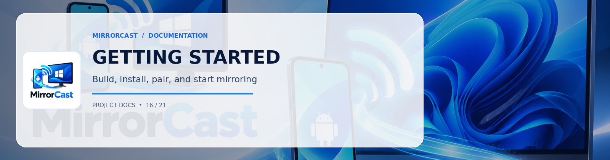

# MirrorCast — Getting Started Guide

This guide walks you through setting up your development environment, compiling both the Android sender and Windows receiver applications, and establishing your first screen mirroring session over local Wi-Fi.

---

## 1. Prerequisites & Environment Setup

### Windows Development Machine
1. **Operating System**: Windows 10 (Build 1809 or higher) or Windows 11 (x64 / ARM64).
2. **.NET 9 SDK**: Ensure .NET 9.0 SDK is installed.
   ```powershell
   dotnet --version
   # Expected output: 9.0.x
   ```
3. **Microsoft Edge WebView2**: Pre-installed on modern Windows 10 & 11. If using an older build or Windows Server, download the Evergreen Bootstrapper from [Microsoft Developer](https://developer.microsoft.com/en-us/microsoft-edge/webview2/).

### Android Development Environment
1. **Java Development Kit**: JDK 17 or JDK 21.
   ```powershell
   java -version
   # Compatible with OpenJDK 17 or OpenJDK 21
   ```
2. **Android SDK**:
   - `build-tools`: `34.0.0` or higher.
   - `platforms`: `android-34` (Android 14) or `android-35` (Android 15).
   - `platform-tools` (containing `adb.exe`).
3. **Physical Android Device**:
   - Android 8.0 (API 26) through Android 15 (API 35).
   - Developer options enabled with **USB Debugging** active.

---

## 2. Building the Applications

### Building the Windows Receiver
From the project root directory, run the automated build script:
```powershell
.\scripts\build-windows.ps1 -Configuration Release
```
This restores all NuGet packages (`Microsoft.Web.WebView2`, `Makaretu.Dns.Multicast`, `QRCoder`), compiles `MirrorCast.Receiver.sln`, and executes the 10 automated unit tests.

The compiled executable is placed at:
```
windows\MirrorCast.Receiver\bin\Release\net9.0-windows\MirrorCast.Receiver.exe
```

### Building the Android Sender
Run the Android build script:
```powershell
.\scripts\build-android.ps1 -Task assembleDebug
```
The output APK is generated at:
```
android\app\build\outputs\apk\debug\app-debug.apk
```

To install the APK directly to your connected Android phone via ADB:
```powershell
adb install -r android\app\build\outputs\apk\debug\app-debug.apk
```

---

## 3. First Mirroring Session Walkthrough

### Step 1: Launch Windows Receiver
Run `MirrorCast.Receiver.exe`. The application opens a dark-themed desktop interface:
- Displays your PC's local IP address (e.g., `192.168.1.55`) and port (`8089`).
- Displays a randomly generated 6-digit PIN (e.g., `492018`).
- Renders a scannable pairing QR code.
- Automatically starts broadcasting the mDNS service `_mirrorcast._tcp`.

> **Firewall Prompt**: If Windows Defender Firewall displays an alert, click **Allow access** for Private networks. Alternatively, click the in-app button **🛡️ Allow Windows Firewall** to register the inbound rule.

### Step 2: Open MirrorCast on Android
Launch **MirrorCast** on your Android device. Ensure your phone is connected to the same Wi-Fi SSID as your Windows PC.

### Step 3: Pair the Devices
Choose either pairing method:
- **Scan QR Code**: Tap **Scan QR Code** on Android and point your camera at the QR code displayed on the PC.
- **Auto-Discovery**: Tap on your PC when it appears in the *Nearby Windows Receivers* list, then enter the 6-digit PIN.
- **Manual IP**: Tap **Manual IP**, enter the PC's IP and port, and submit the PIN.

### Step 4: Grant Screen Capture Consent
When Android prompts:
> *"MirrorCast will have access to everything displayed on your screen"*

Tap **Start now**.

### Step 5: Live Mirroring
Your phone's screen immediately renders on the Windows receiver with hardware acceleration.
- The live telemetry badge on the PC displays real-time **FPS**, **Bitrate (Mbps)**, and **Resolution**.
- Use the **Fit / Fill** button to toggle aspect-ratio preservation.
- Click **Fullscreen** for distraction-free presentation.
- Tap **Stop Mirroring** on Android or close the PC window to release all hardware resources.
