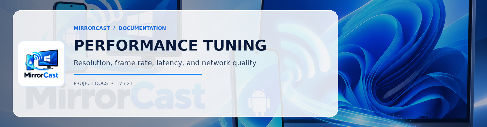

# MirrorCast — Performance & Latency Tuning

This document describes the engineering techniques, network optimizations, and encoder configurations used by MirrorCast to achieve ultra-low latency screen streaming across local Wi-Fi.

---

## 1. Latency Budget Analysis

In a real-time screen mirroring system, total end-to-end (glass-to-glass) latency is the cumulative sum of multiple stages:

```
[Phone Touch/Render] -> [Surface Copy] -> [Hardware Encoder] -> [RTP Packetize] -> [Wi-Fi Hop] -> [Depacketize/Jitter Buffer] -> [Hardware Decoder] -> [D3D11 VSync]
      ~16 ms                 ~2 ms             ~12 ms               ~1 ms            ~8-15 ms               ~5 ms                      ~10 ms               ~16 ms
```

**Target Glass-to-Glass Latency:** **60 ms – 90 ms** on standard 5GHz 802.11ac/ax Wi-Fi.

---

## 2. Android Video Pipeline Optimizations

### 2.1 Zero-Copy Surface Pipeline
MirrorCast avoids costly CPU memory transfers by writing directly from Android's `VirtualDisplay` to an OpenGL ES texture via WebRTC's `SurfaceTextureHelper`.
- Android `MediaProjection.createVirtualDisplay(...)` renders into a native EGL surface.
- The GPU surface buffer is fed directly to the hardware encoder (`MediaCodec`).
- Eliminates any byte-level frame copying across CPU memory space.

### 2.2 Hardware Codec Selection
- **H.264 Baseline / High Profile**: Hardware-accelerated by Qualcomm Adreno, Samsung Exynos, and MediaTek APUs.
- B-frames are explicitly disabled (`bframes=0` / `intra-refresh`) to eliminate frame reordering delays.
- Dynamic keyframe requests (PLI/FIR) are sent only upon packet loss or initial connection rather than regular heavy I-frame bursts.

### 2.3 Congestion & Bitrate Control
- Default maximum bitrate: **8,000 kbps (8 Mbps)** for 1080p 60fps.
- Adaptive step-down: If RTCP reports rising round-trip time (RTT) or packet loss, the encoder dynamically throttles bitrate to **3,500 kbps** without dropping the session.

---

## 3. Windows Receiver & Decoding Optimizations

### 3.1 Direct3D11 / DXVA Hardware Acceleration
- Microsoft WebView2 delegates video decoding directly to Windows Direct3D 11 / DirectX Video Acceleration (DXVA2).
- Incoming H.264 NAL units are processed in the GPU's dedicated video decode engine (e.g. Intel QuickSync, NVIDIA NVDEC, AMD VCN), offloading 100% of the decoding work from the host CPU.

### 3.2 Jitter Buffer Minimization
- Standard media players buffer 2–5 seconds of video for smooth playback.
- MirrorCast configures real-time WebRTC playout delay hints (`playoutDelayHint = 0`), keeping the jitter buffer below 15 milliseconds.

---

## 4. Wi-Fi & Network Recommendations

| Parameter | Recommended | Suboptimal / Avoid |
| :--- | :--- | :--- |
| **Wi-Fi Band** | 5 GHz (802.11ac / 802.11ax Wi-Fi 6) | 2.4 GHz (High congestion from Bluetooth & microwaves) |
| **Channel Width** | 40 MHz or 80 MHz | 20 MHz |
| **Network Type** | Private LAN or Mobile Hotspot | Public Guest Wi-Fi (often enables Client Isolation) |
| **Router Mode** | WPA2 / WPA3-Personal | Networks requiring captive portal login |

### Direct Android Hotspot Option
For zero-interference mirroring in portable environments (e.g. presentations):
1. Enable **Wi-Fi Hotspot** on your Android phone.
2. Connect your Windows PC to the phone's hotspot.
3. MirrorCast will connect directly with single-hop latency (< 50 ms).
