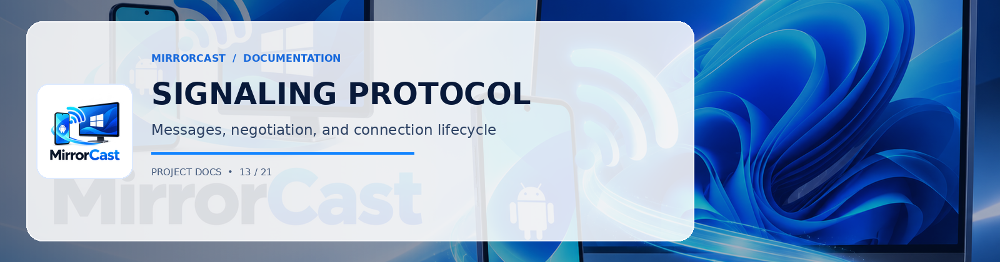

# MirrorCast Signaling Protocol Specification (v1.0)

## 1. Overview
MirrorCast uses a WebSocket signaling channel running over local TCP (default port: `8089`). The signaling channel negotiates session authentication, WebRTC SDP offer/answer, ICE candidates, and runtime control commands.

All messages are UTF-8 JSON objects conforming to [`protocol/signaling-schema.json`](../protocol/signaling-schema.json).

---

## 2. Message Formats

### 2.1 Pairing Request (`pair_request`)
Sent by Android sender upon connecting to the Windows receiver WebSocket.

```json
{
  "version": "1.0",
  "type": "pair_request",
  "payload": {
    "deviceName": "Pixel 8 Pro",
    "pin": "492018",
    "androidVersion": 14,
    "screenWidth": 1080,
    "screenHeight": 2400,
    "preferredFps": 60,
    "preferredCodec": "H264"
  }
}
```

### 2.2 Pairing Response (`pair_response`)
Sent by Windows receiver to accept or deny the connection.

```json
{
  "version": "1.0",
  "type": "pair_response",
  "sessionId": "mc-sess-8f7b2a9e-14d6",
  "payload": {
    "status": "approved", // "approved" | "rejected" | "invalid_pin"
    "receiverName": "DESKTOP-WIN11-MAIN",
    "supportedCodecs": ["H264", "VP8"],
    "maxBitrateKbps": 8000
  }
}
```

### 2.3 WebRTC Offer (`offer`)
Sent by Android sender containing the local session description.

```json
{
  "version": "1.0",
  "type": "offer",
  "sessionId": "mc-sess-8f7b2a9e-14d6",
  "payload": {
    "sdp": "v=0\r\no=- 4238712 2 IN IP4 192.168.1.102\r\n...",
    "type": "offer"
  }
}
```

### 2.4 WebRTC Answer (`answer`)
Sent by Windows receiver in response to the SDP offer.

```json
{
  "version": "1.0",
  "type": "answer",
  "sessionId": "mc-sess-8f7b2a9e-14d6",
  "payload": {
    "sdp": "v=0\r\no=- 8912341 2 IN IP4 192.168.1.55\r\n...",
    "type": "answer"
  }
}
```

### 2.5 ICE Candidate (`ice_candidate`)
Bidirectional trickle ICE candidate exchange.

```json
{
  "version": "1.0",
  "type": "ice_candidate",
  "sessionId": "mc-sess-8f7b2a9e-14d6",
  "payload": {
    "sdpMid": "0",
    "sdpMLineIndex": 0,
    "candidate": "candidate:1 1 UDP 2130706431 192.168.1.102 50004 typ host"
  }
}
```

### 2.6 Control Command (`control`)
Bidirectional control commands for state synchronization.

```json
{
  "version": "1.0",
  "type": "control",
  "sessionId": "mc-sess-8f7b2a9e-14d6",
  "payload": {
    "action": "pause", // "pause" | "resume" | "set_quality" | "rotate"
    "rotation": 90,
    "targetFps": 30,
    "targetBitrate": 4000
  }
}
```

### 2.7 Statistics Telemetry (`stats`)
Periodic telemetry sent by sender or receiver.

```json
{
  "version": "1.0",
  "type": "stats",
  "sessionId": "mc-sess-8f7b2a9e-14d6",
  "payload": {
    "fps": 59.8,
    "bitrateKbps": 5420,
    "packetsLost": 2,
    "rttMs": 14.5,
    "width": 1080,
    "height": 2400
  }
}
```

### 2.8 Disconnect (`disconnect`)
Sent prior to tearing down the session.

```json
{
  "version": "1.0",
  "type": "disconnect",
  "sessionId": "mc-sess-8f7b2a9e-14d6",
  "payload": {
    "reason": "user_stopped" // "user_stopped" | "timeout" | "permission_revoked"
  }
}
```
