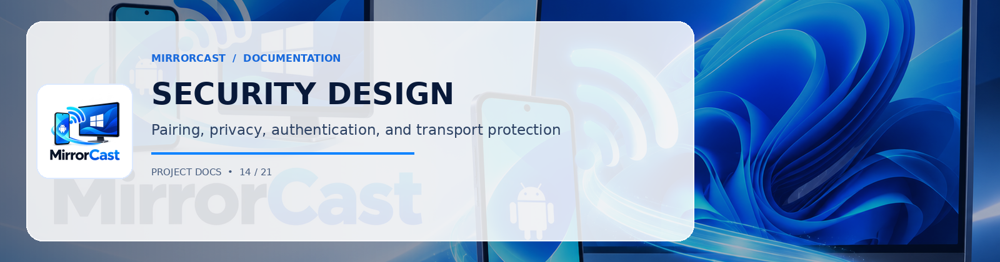

# MirrorCast Security & Privacy Model

## 1. Threat Model & Design Principles

MirrorCast operates strictly within the user's Local Area Network (LAN). It is designed to prevent rogue devices on the same Wi-Fi network from viewing or tampering with the screen stream.

```
[ Android Phone ]                                    [ Windows PC ]
      |                                                     |
      +========== 1. mDNS Discovery (_mirrorcast._tcp) ====>|
      |                                                     |
      +---------- 2. WebSocket Connect (Port 8089) -------->|
      |                                                     |
      +--- 3. pair_request (with 6-digit random PIN) ------>| (Verifies PIN & Prompts User)
      |                                                     |
      |<-- 4. pair_response (Issues Ephemeral SessionId) ---+
      |                                                     |
      +<========= 5. DTLS 1.2 Handshake (ECDHE-ECDSA) =====>+
      |                                                     |
      +<========= 6. SRTP Encrypted Video Transmission ====>+ (AES-128-GCM / HMAC-SHA1)
```

---

## 2. Authentication & Pairing
1. **Dynamic Random PIN**: The Windows receiver generates a cryptographically secure 6-digit PIN (`000000`-`999999`) using `RandomNumberGenerator.GetInt32()`. The PIN rotates every 10 minutes or after 3 failed attempts.
2. **Interactive Approval Prompt**: In addition to PIN entry, when a device connects for the first time, Windows displays a native dialog showing the device model and IP. The user must click **Approve** on their PC.
3. **QR Code Pairing**: The QR code displayed on the Windows receiver encodes a secure payload:
   `mirrorcast://pair?ip=192.168.1.55&port=8089&pin=492018&name=DESKTOP-WIN11`
   This allows instant zero-mistake pairing via Android camera scanning.
4. **Session Token Isolation**: Once approved, an ephemeral cryptographically random GUID is issued. Any signaling packet sent without a valid `sessionId` is dropped immediately with an HTTP/WS 403 error.

---

## 3. Media Transport Security
1. **DTLS-SRTP Encryption**: All media streams (RTP) travel through WebRTC's mandatory DTLS (Datagram Transport Layer Security) with SRTP (Secure Real-time Transport Protocol). Frame contents are encrypted using AES-128 / AES-256 in Galois/Counter Mode (GCM).
2. **Local Network Confinement**: The signaling service only listens on local unicast interfaces. No public ports or UPnP mappings are opened.
3. **No Cloud Relays**: STUN/TURN servers are not used for local connections; traffic flows directly peer-to-peer across Wi-Fi.

---

## 4. Android Privacy Protections
1. **Explicit Consent**: Capture is initiated strictly via `MediaProjectionManager.createScreenCaptureIntent()`. Silent or background capture is impossible under Android security architecture.
2. **Persistent Foreground Notification**: A mandatory foreground service with notification type `FOREGROUND_SERVICE_MEDIA_PROJECTION` displays a persistent status indicator on the phone.
3. **FLAG_SECURE Compliance**: Any screen with banking apps, DRM media, or password fields marked `FLAG_SECURE` is automatically rendered black by the Android OS compositor; MirrorCast does not attempt to bypass this.
