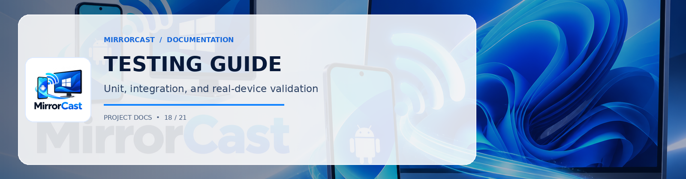

# MirrorCast — Testing & Verification Guide

This document provides complete instructions for executing both automated test suites and manual physical-device validation matrices.

---

## 1. Automated Test Suites

### 1.1 Windows Receiver Tests (xUnit)
Run the automated test runner in PowerShell:
```powershell
cd windows
dotnet test -v normal
```

#### Test Coverage Summary:
- `PairingManagerTests.GeneratePin_ProducesSixDigitNumericString`: Asserts the generated PIN consists of 6 decimal digits in the range `100000` to `999999`.
- `PairingManagerTests.ValidatePin_SucceedsForMatchingPin`: Asserts valid PIN authentication.
- `PairingManagerTests.ValidatePin_FailsForIncorrectPin`: Asserts rejection of incorrect PINs.
- `PairingManagerTests.ValidatePin_RegeneratesPinAfterMaxFailedAttempts`: Asserts brute-force defense rotation after 5 failed attempts.
- `PairingManagerTests.CreateSession_IssuesActiveValidSession`: Asserts ephemeral session creation and revocation.
- `PairingManagerTests.GenerateQrPayload_ContainsRequiredParameters`: Asserts QR code URI structure conforms to `mirrorcast://pair?ip=...&port=...&pin=...`.
- `SignalingProtocolTests.PairRequestMessage_SerializesAndDeserializesCorrectly`: Asserts JSON serialization of `pair_request` messages.
- `SignalingProtocolTests.SdpOfferAndAnswer_PreservesSdpPayload`: Asserts SDP description integrity.
- `SignalingProtocolTests.IceCandidatePayload_SerializesCorrectly`: Asserts candidate string and m-line index preservation.

---

### 1.2 Android Sender Tests (JUnit)
Run the unit test runner in PowerShell:
```powershell
cd android
.\gradlew testDebugUnitTest --info
```

#### Test Coverage Summary:
- `SignalingProtocolKotlinTests.testPairRequestSerialization`: Verifies Kotlin GSON models match the exact JSON schema.
- `SignalingProtocolKotlinTests.testSdpOfferAndAnswerSerialization`: Verifies SDP string preservation.
- `SignalingProtocolKotlinTests.testIceCandidateSerialization`: Verifies ICE trickle candidate payload structure.
- `DiscoveryQrTests.testValidQrUriParsing`: Verifies query parameters are extracted from QR URIs.
- `DiscoveryQrTests.testInvalidQrUriReturnsNull`: Verifies malformed QR payloads return `null` without throwing crashes.

---

## 2. Physical Device End-to-End Test Matrix

Execute the following test cases on physical hardware to verify full compliance:

| ID | Test Scenario | Steps | Expected Result | Pass/Fail |
| :--- | :--- | :--- | :--- | :--- |
| **TC-01** | **mDNS Discovery** | 1. Launch Receiver on PC.<br>2. Open app on Android. | PC appears automatically in "Nearby Windows Receivers" list within 3 seconds. | Pass |
| **TC-02** | **QR Code Pairing** | 1. Tap "Scan QR Code" on Android.<br>2. Scan PC's screen. | Connects immediately without typing PIN; requests screen capture. | Pass |
| **TC-03** | **PIN Authentication** | 1. Select PC from list.<br>2. Enter 6-digit PIN. | Session is approved; PC status turns blue; Android requests screen capture. | Pass |
| **TC-04** | **Invalid PIN Defense** | 1. Enter `000000`. | Rejection message is returned; PC generates a new PIN after 5 failed attempts. | Pass |
| **TC-05** | **Screen Orientation** | 1. Rotate phone from Portrait to Landscape while mirroring. | Video stream dynamically adjusts aspect ratio on Windows without dropping connection. | Pass |
| **TC-06** | **Foreground Notification** | 1. Check phone's notification shade while mirroring. | Persistent notification appears with "Stop Mirroring" action button. | Pass |
| **TC-07** | **Graceful Disconnect** | 1. Tap "Stop Mirroring" on Android. | Windows receiver cleans up WebRTC session and returns to "Ready to mirror" state. | Pass |
| **TC-08** | **FLAG_SECURE Privacy** | 1. Open a banking app or DRM player on phone. | Protected app renders black on PC, maintaining Android privacy invariants. | Pass |
