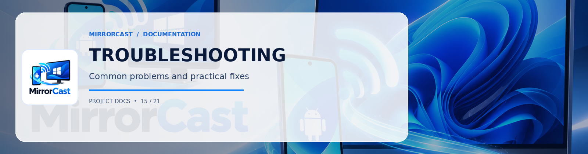

# MirrorCast Troubleshooting Guide

This guide covers common issues and exact resolutions for network, firewall, permissions, and media transport issues.

---

## 1. Network & Receiver Discovery Issues

### Symptom: Android app says "No Windows receivers found"
1. **Wi-Fi Subnet Verification**:
   - Both phone and PC must be connected to the exact same Wi-Fi SSID / local subnet.
   - Run `ipconfig` on Windows to check the IP address (e.g. `192.168.1.55`).
   - Check Phone IP under Android **Settings > Network & Internet > Wi-Fi > Network details**.
2. **Access Point Client Isolation**:
   - Many public Wi-Fi or guest networks enable "Client Isolation" / "AP Isolation", preventing wireless clients from communicating with each other.
   - **Fix**: Connect both devices to a private home/office Wi-Fi network or an Android Wi-Fi Hotspot created by the phone itself.
3. **Manual Connection Fallback**:
   - On the Android app, tap **Manual IP Connect**.
   - Enter the IP address and port displayed on the Windows Receiver home screen (e.g., `192.168.1.55:8089`) and the 6-digit PIN.

---

## 2. Windows Firewall Permissions

### Symptom: Connection times out or refuses connection
Windows Firewall often blocks incoming connections on newly opened ports for unlisted applications.

**PowerShell Command to Allow MirrorCast Receiver (Run as Administrator):**
```powershell
New-NetFirewallRule -DisplayName "MirrorCast Windows Receiver" `
  -Direction Inbound `
  -Protocol TCP `
  -LocalPort 8089 `
  -Action Allow `
  -Profile Private,Domain
```

For WebRTC dynamic UDP media ports:
```powershell
New-NetFirewallRule -DisplayName "MirrorCast WebRTC UDP" `
  -Direction Inbound `
  -Protocol UDP `
  -LocalPort 50000-50100 `
  -Action Allow `
  -Profile Private,Domain
```

---

## 3. Android Screen Capture & Service Permissions

### Symptom: "Permission denied" or crash when starting capture
1. **Android 14+ Foreground Service Type Requirement**:
   - Android 14 (API 34) mandates `android.permission.FOREGROUND_SERVICE_MEDIA_PROJECTION` in `AndroidManifest.xml` AND the service must declare `android:foregroundServiceType="mediaProjection"`.
2. **Service Start Timing**:
   - On Android 14+, the foreground service MUST be started before or immediately upon receiving the `MediaProjection` token from `onActivityResult`. Attempting to start projection without an active foreground service causes `SecurityException`.
3. **Session Re-use**:
   - Android 14 introduces single-use projection tokens. If mirroring is stopped, a new system consent intent MUST be prompted.

---

## 4. Video Playback & Performance

### Symptom: High latency, stuttering, or dropped frames
1. **5GHz Wi-Fi**: 2.4GHz Wi-Fi is prone to Bluetooth interference and low throughput. Use 5GHz or 6GHz Wi-Fi.
2. **Quality Profile**: In the Android app Settings, switch from **1080p 60fps** to **720p 30fps** with **Adaptive Bitrate enabled**.
3. **Hardware Acceleration on Windows**: Ensure the Windows GPU drivers are up to date. Microsoft WebView2 hardware acceleration is enabled by default.
